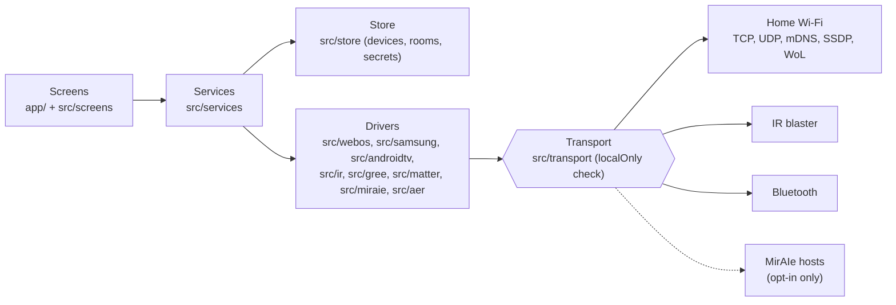

# One Remote

One Remote is one simple, private remote for the devices at home: the TV, the ACs, the fans and the
air freshener. It talks to them directly, over the home Wi-Fi, the phone's IR blaster or Bluetooth.
No ads, no account, no cloud. It runs on Android and iPhone.

**Status: beta.** Builds go to the Google Play internal testing track. It is tested against fake
devices in the test suite, and on a small bench of real ones: an LG C4 TV, an Android TV box, a
Panasonic AC and Atomberg fans. Most other brands are not tried on real hardware yet. See
[Project status](#project-status).

Unofficial. Not affiliated with LG, Samsung, Google, Panasonic, Atomberg, Godrej or any other device
maker.

<p>
  <a href="LICENSE"></a>
  
  
  
  
  <a href="https://github.com/DevanshChoubey/one-remote/actions"></a>
</p>

## Contents

- [Why it exists](#why-it-exists)
- [Features](#features)
- [Privacy](#privacy)
- [Compatibility](#compatibility)
- [Getting started](#getting-started)
- [How it works](#how-it-works)
- [Project status](#project-status)
- [FAQ](#faq)
- [Contributing](#contributing)
- [Licence](#licence)
- [Credits](#credits)
- [Disclaimer](#disclaimer)

## Why it exists

Every device at home comes with its own app: LG ThinQ for the TV, another for the AC, another for
the fans. Most want an account, many are slow or full of extras, and some only work through the
maker's cloud, even when the device sits on the same Wi-Fi as the phone.

One Remote puts them in one app, with the best layout for each kind of device:

- **Simple.** The TV remote is laid out like Google's TV remote: a big touchpad and few buttons. The
  AC is a dial; the fan is a row of speeds.
- **Private.** It talks to the devices directly, on the home network. No account, no analytics.
- **Honest.** It shows what the device reports where it can, and says when it cannot know, such as
  for an AC over IR.

## Features

| Device        | How it connects      | What it does                                                                                                                                              |
| ------------- | -------------------- | --------------------------------------------------------------------------------------------------------------------------------------------------------- |
| TV            | Home Wi-Fi           | LG webOS, Samsung (Tizen) and Android TV / Google TV. Touchpad or D-pad, volume, inputs, a keyboard, hold-to-talk voice (Android TV), on/off state.       |
| TV power on   | Wake-on-LAN or IR    | Turns the TV on when it is in standby.                                                                                                                    |
| AC            | IR blaster (Android) | Panasonic, Carrier, Daikin, Gree, Haier, Hitachi, LG, Midea, Mitsubishi Heavy, Samsung, Voltas, Whirlpool. Likely code sets for Blue Star, Godrej, Lloyd. |
| AC            | Home Wi-Fi           | Gree units over their local protocol, and ACs with Matter, added by their QR code.                                                                        |
| AC (opt-in)   | MirAIe cloud         | Panasonic Wi-Fi ACs sold in India, off by default. See [Privacy](#privacy).                                                                               |
| Fan           | IR blaster (Android) | Atomberg fans: power, speeds, boost, sleep and light.                                                                                                     |
| Air freshener | Bluetooth            | Godrej aer Smart Matic: spray now, auto spray, schedules, battery and refill, and alerts planned on the phone.                                            |
| Rooms         |                      | Devices grouped by room on the home screen.                                                                                                               |
| IR backup     |                      | Add an IR remote to a Wi-Fi device, for when the network is down.                                                                                         |
| Themes        |                      | Light, dark, or match the phone. Follows the phone's reduce-motion setting.                                                                               |
| Accessibility |                      | Labels and roles on every control, 48 dp touch targets, text that scales, AA contrast.                                                                    |

For the Panasonic AC, the IR remote also has Powerful, Quiet, swing positions, five fan speeds and
nanoe.

## Privacy

One Remote collects nothing and sends nothing to a server of its own.

- **Local network only.** Every connection goes through a check (`src/transport/localOnly.ts`) that
  refuses any address outside the home network. ESLint bans `fetch` and `XMLHttpRequest`
  everywhere, and sockets live only in `src/transport`. Android needs the `INTERNET` permission for
  any socket, local ones included, so it stays.
- **One opt-in exception.** The MirAIe cloud connection for Panasonic ACs is off by default. When you
  turn it on in Settings, the app signs in to your own MirAIe account and talks only to
  `auth.miraie.in`, `app.miraie.in` and `mqtt.miraie.in`, over TLS. Disconnect deletes the saved
  sign-in from the phone.
- **No account, analytics, ads or telemetry.** Config plugins remove Google ML Kit's usage logging
  (`plugins/withNoGoogleTelemetry.js`) and the Firebase push components (`plugins/withNoPush.js`).
- **No location.** The location permissions are blocked, and Bluetooth scanning uses
  `neverForLocation`.
- **Local data only.** Devices, rooms and settings stay on the phone. TV pairing keys and the MirAIe
  sign-in are kept in the phone's secure storage.

The full [privacy policy](PRIVACY.md) is the one linked from the store listing. See
[SECURITY.md](SECURITY.md) for the scope and how to report a problem.

## Compatibility

| Item    | Supported                                                                                |
| ------- | ---------------------------------------------------------------------------------------- |
| Android | A real phone. IR needs a phone with an IR blaster (many Xiaomi, iQOO and Vivo phones).   |
| iPhone  | Everything except IR, since iPhones have no IR blaster.                                  |
| Network | The phone and the devices on the same home Wi-Fi.                                        |
| Builds  | A development or release build. Expo Go is not supported, because of the native modules. |

## Getting started

You need [Bun](https://bun.sh) and a real phone. Simulators and emulators have no IR or Bluetooth,
and usually cannot see the TV on the home network.

### Android (on Linux, macOS or Windows)

You need Bun, the JDK (17), the Android SDK with `ANDROID_HOME` set, and an Android phone with USB
debugging on, plugged in.

```sh
git clone https://github.com/DevanshChoubey/one-remote.git
cd one-remote
bun install
bunx expo run:android
```

### iOS (on a Mac)

You need Xcode, CocoaPods, and Developer Mode on the iPhone (Settings, Privacy & Security).

```sh
git clone https://github.com/DevanshChoubey/one-remote.git
cd one-remote
bun install
bunx expo run:ios --device
```

Pick your phone when asked. If signing fails, open the `.xcworkspace` under `ios/` in Xcode, choose
your team under Signing & Capabilities and sign in with a free Apple ID.

### Release builds

A development build needs Metro running on your computer. For an app that works away from the
computer, install a release build:

```sh
bunx expo run:android --variant release
bunx expo run:ios --device --configuration Release
```

An Android release build is signed with the debug key unless the `ONE_REMOTE_UPLOAD_*` variables are
set (`plugins/withReleaseSigning.js`). [docs/store/google-play.md](docs/store/google-play.md)
explains the upload key and the Play release.

### Development

```sh
bun run android   # build, install and start the development build (bun run ios on the Mac)
bun run start     # start Metro for an installed build
bun run test
bun run typecheck
bun run lint
```

## How it works

Screens never talk to devices directly. They call services, and each kind of link (webOS, Samsung,
Android TV, IR, Gree, Matter, MirAIe, aer) has a driver in plain TypeScript. All networking sits in
one layer, where the local-only check runs.



Read more:

- [docs/ENGINEERING.md](docs/ENGINEERING.md): the rules every change follows.
- [docs/design/one-remote-mockup.html](docs/design/one-remote-mockup.html): the central mock, with
  all screens, states and motion (open it in a browser).
- [docs/research/2026-10-30-market-and-validation.md](docs/research/2026-10-30-market-and-validation.md):
  why this app, the market scan, the test devices and the technical findings.
- [docs/protocol/](docs/protocol/): the MirAIe cloud and aer Bluetooth protocol notes.

## Project status

| Area                     | State                                                                            |
| ------------------------ | -------------------------------------------------------------------------------- |
| LG webOS TV              | Works on an LG OLED C4.                                                          |
| Android TV / Google TV   | Pairing, keys, volume and voice work on an Android TV box. More checks pending.  |
| Samsung TV               | Built and tested against a fake TV. Not tried on a real TV yet.                  |
| Panasonic AC over IR     | Power on (Cool 24) and off work on a real AC.                                    |
| Other AC brands over IR  | Built from IRremoteESP8266 and its test vectors. Not tried on real ACs yet.      |
| Gree, Matter, MirAIe ACs | Built and tested against fakes. Real-device checks pending.                      |
| Atomberg fan             | Power works on a real fan. Speeds, boost, sleep and light are not confirmed yet. |
| Godrej aer               | Uses the protocol from Aer Remote, which passed its hardware test on Android.    |
| Play Store               | Internal testing. Closed testing and production are next.                        |

If you have one of these devices, a [device report](CONTRIBUTING.md#report-a-device-result) helps
the most.

## FAQ

### Which phones can control ACs and fans?

Those with an IR blaster: many Xiaomi, Redmi, Poco, iQOO and Vivo phones, and some others.
iPhones and most Samsung and Pixel phones have none. On many phones the blaster is on the top edge;
on some, such as the iQOO Z10x, it is on the back, so aim the camera side at the device. Wi-Fi ACs
(Gree, Matter, MirAIe) work without one.

### Why does a TV ask to pair again?

A TV can forget a paired app after a reset or a firmware update. Pair again from the TV's menu
(the ⋯ button) and accept the prompt on the TV.

### Why is the AC's state a guess over IR?

IR goes one way: the AC does not answer. The app shows what it last sent. If someone uses the
physical remote, the app cannot know. Wi-Fi ACs (Gree, Matter, MirAIe) report their real state.

### What does the MirAIe connection send, and to whom?

Only with it on: your MirAIe phone number and password to Panasonic's sign-in server, and commands
and state for the ACs you add through MirAIe. Nothing about your other devices. See the
[privacy policy](PRIVACY.md#miraie-cloud-connection-opt-in).

### Does it need the internet or an account?

No. See [Privacy](#privacy).

## Contributing

Contributions are welcome, especially device test reports for TVs, AC and fan brands, and IR codes.
Read [CONTRIBUTING.md](CONTRIBUTING.md) first. In short: Bun only, follow
[docs/ENGINEERING.md](docs/ENGINEERING.md), run `bun run test`, `bun run typecheck` and
`bun run lint`, and use Conventional Commits. Please follow the
[Code of Conduct](CODE_OF_CONDUCT.md).

## Licence

One Remote is under the MIT licence. See [LICENSE](LICENSE).

The one exception is `src/ir/lgpl/`, the AC IR encoders derived from IRremoteESP8266, and their test
vectors in `tests/ir/lgpl/`. They stay under the GNU LGPL, version 2.1, with their own
[LICENSE](src/ir/lgpl/LICENSE) and [NOTICE.md](src/ir/lgpl/NOTICE.md). See [NOTICE](NOTICE) for
every third-party credit.

## Credits

One Remote includes or adapts code from these projects. Thank you to their authors.

| Project                                                            | Licence    | Used for                                                                  |
| ------------------------------------------------------------------ | ---------- | ------------------------------------------------------------------------- |
| [IRremoteESP8266](https://github.com/crankyoldgit/IRremoteESP8266) | LGPL-2.1   | The AC IR encoders in `src/ir/lgpl/`, ported to TypeScript.               |
| [lgtv2](https://github.com/hobbyquaker/lgtv2)                      | MIT        | The signed SSAP registration manifest for older LG TVs (`src/webos`).     |
| [androidtvremote2](https://github.com/tronikos/androidtvremote2)   | Apache-2.0 | The Android TV Remote v2 message layout and pairing code check.           |
| [@matter/react-native](https://github.com/matter-js/matter.js)     | Apache-2.0 | The React Native network layer for matter.js, adapted for local-only use. |
| [Flipper-IRDB](https://github.com/Lucaslhm/Flipper-IRDB)           | CC0-1.0    | The Atomberg fan IR codes.                                                |

It is built on [matter.js](https://github.com/matter-js/matter.js) (Apache-2.0), Expo, React Native
and other open-source libraries, each under its own licence. The Godrej aer protocol work comes
from the author's [Aer Remote](https://github.com/DevanshChoubey/aer-remote) (MIT).

## Disclaimer

One Remote is an unofficial, independent project. It is not affiliated with, endorsed by or
supported by LG, Samsung, Google, Panasonic, Atomberg, Godrej or any other device maker. Brand and
product names are trademarks of their owners and are used here only to describe compatibility. Use
the app at your own risk.
